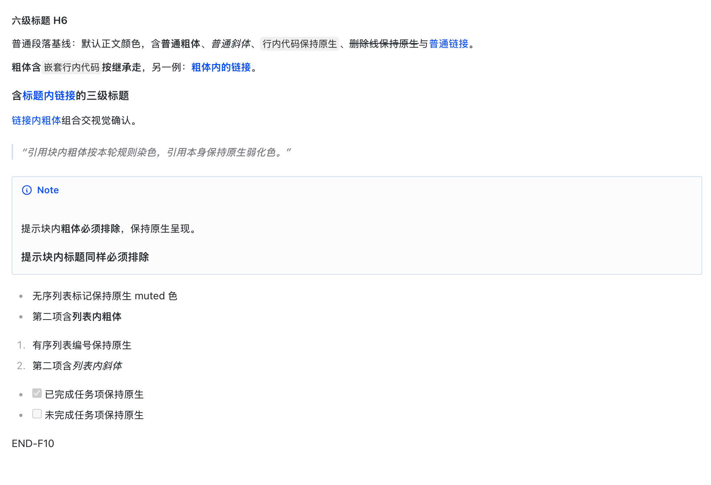
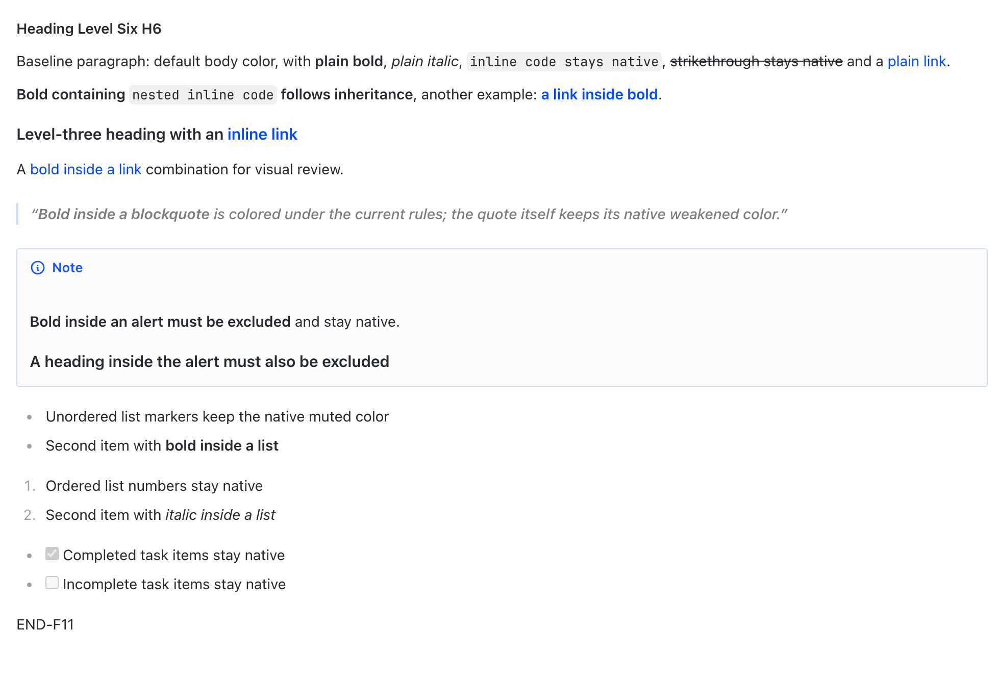
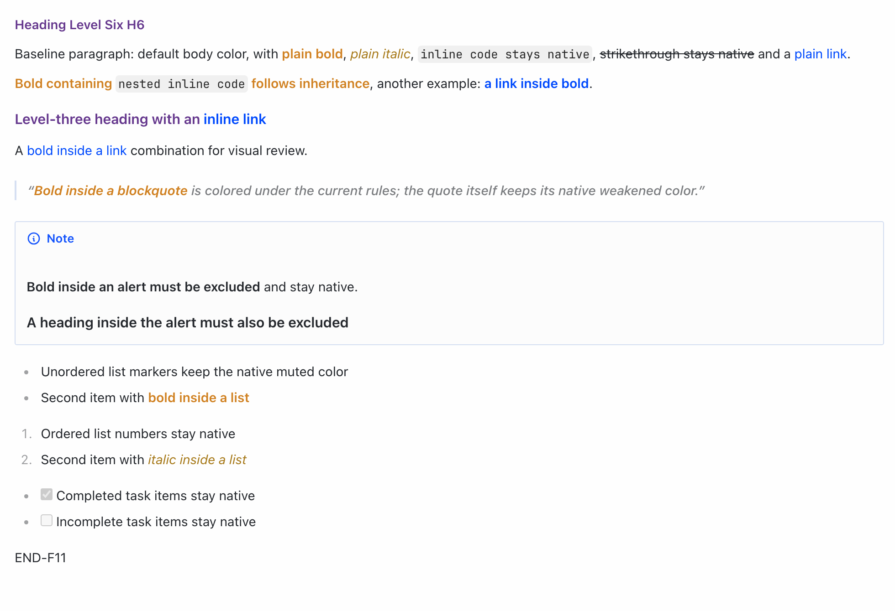
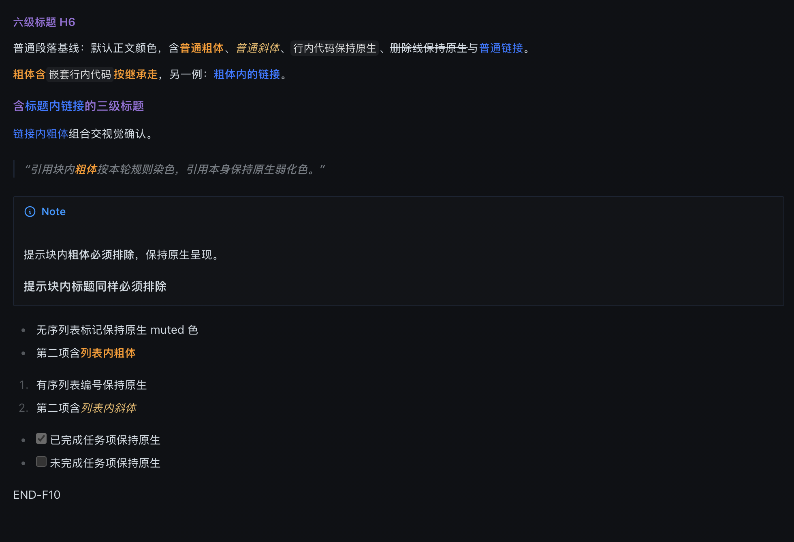
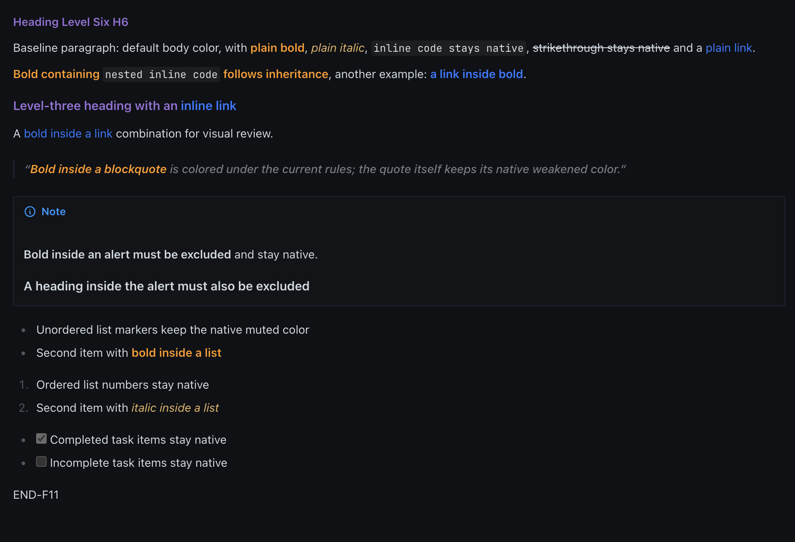
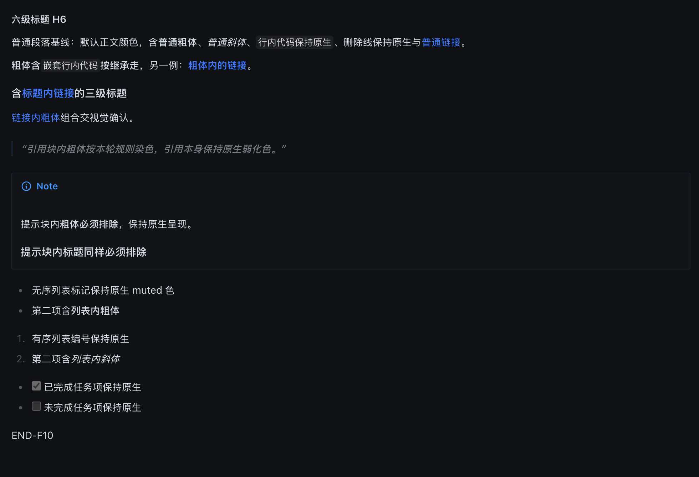
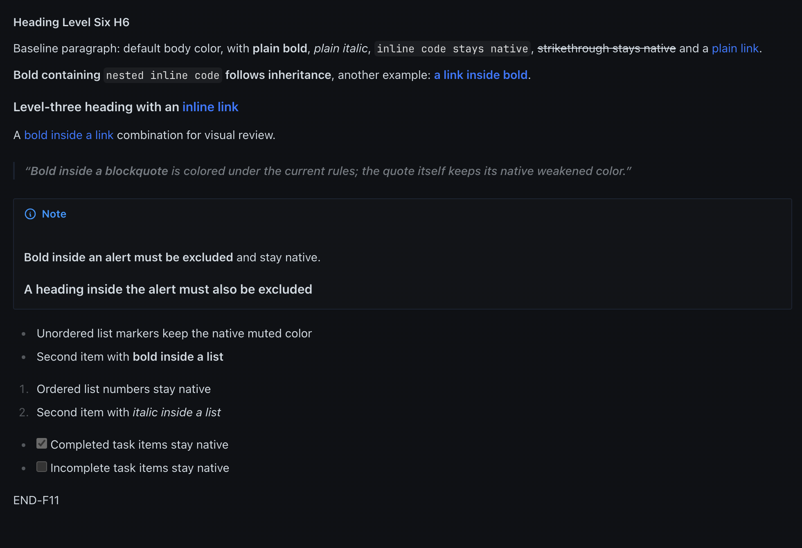

# hermes-output-enhancement

Style-only content presentation plugin for [Hermes Desktop](https://hermes-agent.nousresearch.com/docs). It adjusts how **existing** Markdown renders in assistant replies — headings, bold and italic emphasis and tables — and nothing else.

> Unofficial community plugin. Not affiliated with or endorsed by Nous Research.

## The guarantee: display only

- Enabling injects exactly one `<style>` element into the page; disabling or uninstalling removes it. That is the plugin's entire runtime footprint.
- Reply content is never modified: no rewriting, summarizing, adding, deleting or reordering. Heading levels, list order, code content and whitespace, link text and targets, and table row/column counts, headers and cell values stay exactly as the model produced them.
- No model or gateway calls, no session reads, no writes to SOUL, profiles, memory or conversation history.
- This plugin contains no host patch and never modifies the Hermes application.

## Current status

- Version `0.1.5`, **off by default**; opt in via the app's own plugin toggle. (v0.1.5 aligns the plugin description with what the CSS actually styles — headings, bold and italic text, tables — and states explicitly that inline code keeps the native Hermes styling, as it has since v0.1.1. v0.1.3 renamed the plugin to **Hermes Output Enhancement** with stable id `hermes-output-enhancement` and a new install directory; v0.1.2 and earlier shipped as `hermes-style-plugin`.)
- v0.1.2 color scheme: component-level 29/29 checks and an isolated native four-quadrant run (light/dark × on/off, 22/22 checks) verified headings/bold/italic coloring with inline code, font weights, list markers, alerts, link colors and strikethrough kept native.
- The repository ships the natively tested build as a pre-built distribution directory (`plugin/hermes-output-enhancement/`, plugin-catalog layout with `plugin.yaml` + `desktop/plugin.js`) — see *Install*; no build step is needed.
- Native verification on stock macOS arm64 builds of the Hermes 0.22.x line (most recently 0.22.6 / Electron 44.9.3 / Chromium 152.0.7977.167 / Node 24.22.0): **10 of 11 checks passed**.
- Known limitation on stock builds: toggling the plugin does **not** sync to other already-open windows until the app is restarted. This is Hermes host behavior (`plugins-store.ts` persists the decision but applies it only in the toggling window), not something this plugin can fix from inside the plugin sandbox. Tracked upstream at [#149541](https://github.com/NousResearch/hermes-agent/issues/149541). A host-side fix for this limitation was developed and verified separately by ANNIPU (12/12 native checks on a patched build); it is **not** part of this repository — this repository ships the plugin only.
- Interaction coverage on the patched build: the code-block `Copy code` button's clipboard output is byte-identical to the fixture contract in every light/dark × on/off combination, a real column-drag resize keeps all five columns and every cell in both plugin states (the drag state persists across reloads), and dark mode — switched via the app's own palette command — preserves content structure. Link handling is covered by a dedicated fixture of explicit fake `.invalid` URLs: a real click is handled by the app's own browsing layer (a managed-browser consent dialog on the first click per session; subsequent clicks open the app's internal browser pane), and declining the dialog leaves the page and link structure unchanged (verified with the style on and off; the dialog's re-appearance timing is Hermes host behavior). An earlier revision of this paragraph claimed an intercepted external handoff with the exact href — that claim was wrong (the original fixture contained no links) and is retracted. The native UI offers no separate table-copy button (the whole-reply Copy covers tables). Windows and Linux remain untested.
- Hermes's plugin static scan (`hermes plugins validate`) reports 0 rejections and 1 `app markup selector` review notice — the styling targets the app's assistant-message DOM container, disclosed for review.

## What changes visually

Within assistant replies only — ordinary paragraphs, user messages and app chrome are untouched:

- Headings H1–H6: violet accent in both themes — deep `#704098` on light, `#9d7cd8` on dark; same violet family, adjusted for each theme.
- Bold: orange accent (`#d68c27` light / `#f5a742` dark). Italic: gold (`#b0851f` light / `#e5c07b` dark). Font weights stay native — nothing is forced bolder.
- Inline code: left fully native (the tinted-chip styling of earlier alphas was removed in v0.1.2).
- Tables: layout enhancements kept — distinct header row, full grid, roomier cells, smarter first-column width for two-column tables — with header text back to its native muted tone. All data is preserved; wide tables scroll instead of being crushed.
- Exclusions: alerts/callouts, code blocks, list markers, strikethrough and link colors stay native in every tested state; emphasis nested inside a link follows the emphasis color (visible in the snapshots below).

Colors follow the active theme's light/dark variants.

## Snapshots (v0.1.2)

Same-content four-quadrant comparisons captured from the real desktop app in an isolated native run (plugin bytes `65c3fdfa…`). Each row is one theme × plugin state; columns are the Chinese and English fixture runs.

| Theme × state | zh-CN | English |
|---|---|---|
| Light / off |  |  |
| Light / on |  |  |
| Dark / on |  |  |
| Dark / off |  |  |

## Build (only if you change the stylesheet)

Requires Node.js 22+. No npm dependencies.

```sh
npm run build
```

This regenerates `plugin/hermes-output-enhancement/desktop/plugin.js` and
`build-info.json` from `styles/p1-candidate.css`. The stylesheet is the source
of truth; edit it, not the generated file. The build also verifies that the
version in `plugin.yaml` matches `package.json`. The committed `plugin/` files
are the pre-built distribution (see *Install*) — most users never need this
step.

## Install

No build is needed: the repository ships the natively tested plugin as a
pre-built distribution directory, `plugin/hermes-output-enhancement/`.

Once the plugin-catalog entry is merged (recommended):

```bash
hermes plugins install hermes-output-enhancement
```

Manual alternative: copy the whole `plugin/hermes-output-enhancement/`
directory to `<home>/.hermes/desktop-plugins/hermes-output-enhancement/` —
those files are all it takes (no npm package, no separate CSS file). Keep the
folder name — it matches the plugin id. The app watches this directory: the
plugin appears in Settings → Capabilities → Plugins, **disabled by default**;
enable/disable with its toggle, Uninstall on the plugin's detail page removes
the directory.

Installing the plugin does not include any host-side multi-window fix: on
stock Hermes builds the window-sync limitation above remains until upstream
ships one (see [#149541](https://github.com/NousResearch/hermes-agent/issues/149541)).

## Migrating from the old identity (≤ 0.1.2)

The plugin was renamed in v0.1.3 — new stable id `hermes-output-enhancement`, new install directory. Old and new are separate plugins to Hermes, so:

1. Disable **Hermes Output Style Enhancement** in Settings → Capabilities → Plugins, then quit Hermes.
2. Delete the old directory: `rm -rf ~/.hermes/desktop-plugins/hermes-style-plugin`.
3. Install this version (see *Install*). The new plugin starts **off** by default — the old toggle preference is not inherited.

## Compatibility

The stylesheet targets the app's current DOM structure and may need adjusting after Hermes updates. Native testing covers the stock macOS arm64 builds listed under *Current status* (Hermes 0.22.x, most recently 0.22.6); treat other versions as unverified. `plugin.yaml` declares `requires_hermes: ">=0.22.6"` accordingly.

The repository ships the pre-built distribution directory `plugin/hermes-output-enhancement/` (the exact bytes that passed native verification). `npm run build` regenerates `desktop/plugin.js` and `build-info.json` from the stylesheet; a rebuilt `desktop/plugin.js` only counts as the tested candidate when its SHA-256 matches the shipped `pluginSha256`.

## License

MIT — see [LICENSE](LICENSE). Copyright (c) 2026 ANNIPU.
